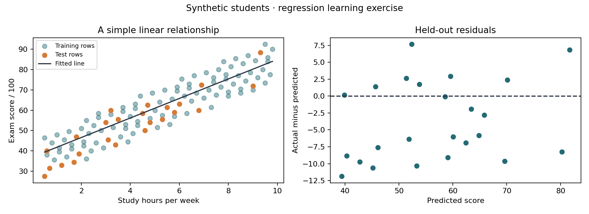

# Study Hours and Exam Score Regression

A regression analysis comparing a linear model with a training-mean baseline. The project applies CRISP-DM, separates training and test data, and evaluates prediction errors on held-out observations.

## Results

| Model | Test MAE | Test RMSE | Test R² |
|---|---:|---:|---:|
| Linear regression | 5.89 | 6.87 | 0.768 |
| Training-mean baseline | 13.72 | 17.39 | -0.489 |

The linear model has lower prediction error on the fixed test split. MAE and RMSE are measured in score points. These results describe a **synthetic dataset with a deliberately linear relationship**. [View the example report](docs/example-report.md).

## Methodology

| CRISP-DM phase | Implementation |
|---|---|
| Business understanding | Assess whether study hours improve predictions over a training-mean baseline. |
| Data understanding | Inspect feature ranges, missing inputs, and the relationship with exam scores. |
| Data preparation | Validate records; split 80/20; fit median imputation on training rows only. |
| Modeling | Fit LinearRegression and DummyRegressor on the same training data. |
| Evaluation | Compare MAE, RMSE, R², and residuals on the same held-out test set. |
| Deployment | Export metrics, predictions, a report, and visualizations through a reproducible script. |

The split uses <code>random_state=42</code>, producing 96 training rows and 24 test rows. A scikit-learn pipeline fits the imputer and regression model together using only training data. Student IDs are excluded from model inputs.

The fitted model has the form:

~~~text
predicted score = intercept + slope × study hours
residual = actual score − predicted score
~~~

The baseline predicts the training-set mean. R² uses the test-set mean as its reference, so the baseline's test R² can be negative.

## Dataset

[students.csv](data/students.csv) contains 120 fictional observations, including two missing study-hour values.

| Field | Description |
|---|---|
| student_id | Unique fictional ID, excluded from prediction |
| study_hours | Weekly study hours; the sole input feature |
| exam_score | Target score out of 100 |

[make_demo_data.py](make_demo_data.py) generates scores from <code>35 + 5 × study_hours + deterministic noise</code>. The known relationship supports reproducibility; it does not establish a model of actual student performance.

## Installation and usage

Requires **Python 3.11–3.13**.

~~~bash
git clone https://github.com/Farscent/study-hours-regression.git
cd study-hours-regression
python -m venv .venv
~~~

Activate the environment with <code>.\.venv\Scripts\Activate.ps1</code> on Windows PowerShell or <code>source .venv/bin/activate</code> on macOS/Linux.

~~~bash
python -m pip install -r requirements.txt
python model.py
python model.py --hours 4
~~~

The included data runs offline after dependency installation.

The optional <code>--hours</code> argument returns a prediction from the training-fitted model and rejects values outside the observed training range.

## Outputs

| File | Contents |
|---|---|
| outputs/report.md | Model comparison and interpretation |
| outputs/metrics.json | Evaluation metrics, split sizes, imputation value, and coefficients |
| outputs/test_predictions.csv | Held-out scores, predictions, and residuals |
| outputs/regression.png | Fitted line and residual plot |

## Limitations

The data is small, synthetic, and deliberately linear. The results demonstrate the analysis pipeline rather than real-world predictive validity. Study hours alone omit many factors associated with academic performance, and association does not establish causation.

A single test split has sampling uncertainty. The model provides no prediction intervals and does not constrain predictions to 0–100. Any model selection would require validation within the training data while keeping the final test set untouched.

## Notebook

[View the analysis notebook](walkthrough.ipynb) for intermediate tables, visualizations, and saved outputs. To run it locally:

~~~bash
python -m pip install -r requirements-notebook.txt
python -m notebook walkthrough.ipynb
~~~

## Validation

Tests cover training/test separation, training-only imputation, metric calculations, a known linear relationship, prediction bounds, and report generation. CI also reproduces the dataset and executes the notebook.

~~~bash
python -m unittest discover -s tests -v
~~~

GitHub Actions runs the checks on Python 3.11 and 3.12. The project has also been verified on Windows with Python 3.13.

## References

- [scikit-learn: common pitfalls and data leakage](https://scikit-learn.org/stable/common_pitfalls.html)
- [IBM: CRISP-DM overview](https://www.ibm.com/docs/en/spss-modeler/saas?topic=dm-crisp-help-overview)

## License

Code and synthetic demonstration data are available under the [MIT License](LICENSE).
